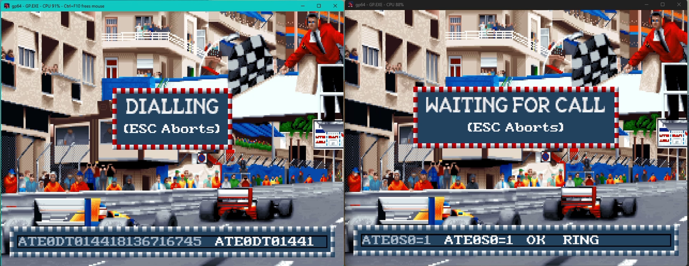
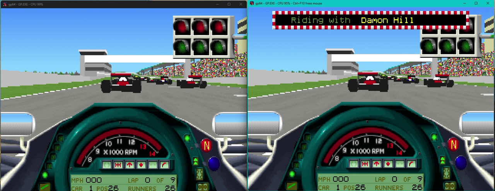
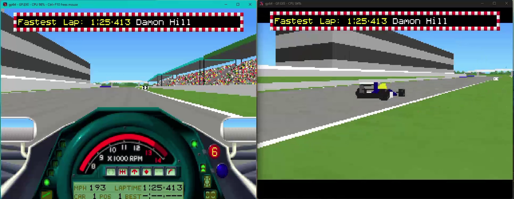

# gp64

Run Geoff Crammond's original Formula One Grand Prix (F1GP) on Windows 11 and macOS.
Copy gp64 into your existing game folder and run it. The game starts as it
did on a DOS PC, with its own graphics, sound, controls and two-player links.

gp64 runs your own unmodified copy by emulation, not decompilation. Under the
hood it is a cut-down DOS emulator in Rust: a real-mode PC, DOS and BIOS
services, VGA video, keyboard and mouse, PC speaker and AdLib audio, and a
null-modem cable and a serial modem carried over TCP on the local network.
No DOS installation or ROM image is required.

This is a personal project with irregular maintenance. Contributions and pull
requests are not accepted; forks are welcome under GPL-3.0-or-later. There is no
promise of support, fixes or future releases. See [CONTRIBUTING.md](CONTRIBUTING.md).

## Screenshots

Two copies of gp64 on one PC, linked by their emulated modems: one dials while
the other waits for the call.



The race start, seen from both linked copies.



A fastest-lap message arriving on both copies at once.



The screenshots show the game's own artwork, which belongs to its rights
holders and is not covered by gp64's licence.

## Drop-in launch

Copy gp64 into your own F1GP folder and run it. It starts the normal batch launcher, or the executable if the batch file is absent.

The folder is mounted as writable drive C:, so the program can save its own
settings and progress. An explicit program path mounts that program's folder
instead. Recording starts only when requested with `--record` or from the
F12 menu. Menu recordings go to the user's video folder, with a fallback when
that folder is unavailable.

```sh
./gp64
./gp64 --mute
./gp64 /path/to/program.exe argument
```

## Options and controls

```text
gp64 [--mute] [--record FILE] [--script FILE] [--wait] [program [args]]
```

- `--mute`: disable host audio output.
- `--record FILE`: record video and audio to an MKV/WebM file, finalised on exit.
- `--script FILE`: drive the program from an emuscru script, then exit (see
  [Scripted runs](#scripted-runs)). Implies `--wait`.
- `--wait`: on Windows, keep the prompt until gp64 exits and print its messages
  there. Without it, gp64 returns to the prompt once started and shows a
  failure in a message box.
- `--help` and `--version`: print help or version.

For two players, run gp64 on two machines on the same local network, or twice
on one machine. In each copy, turn on F12 → Serial for a null-modem cable on
COM1, or F12 → Modem for a modem on COM2. The two copies find each other and
connect by themselves; the menu row shows the other machine once connected.
Then use F1GP's own serial-link or modem setup on that COM port.

In F1GP's link setup, choose the fastest port speed, such as 19200. That
setting is the speed of the cable between the PC and its modem, not the
modem's line speed (gp64's modem connects at up to 14400). F1GP exchanges
data every frame, so on a 2400 bps cable it spends most of its time waiting
and plays slowly however fast the host is. The serial link has no modem
delay, so it is the quickest of the two.

Both links are off by default, and gp64 opens no network sockets until one is
turned on. A link then listens on a TCP port chosen by the system and
advertises it with UDP broadcasts on ports 23517–23520, so the first use may
raise a firewall prompt. The choices are saved for later runs.

- F12 opens the host menu: scaler, fullscreen, mute, recording, serial and
  modem. The menu pauses the program unless a link is connected. Escape or F12
  closes it.
- F11 cycles integer nearest-neighbour, smooth, area and CRT scaling, with 4:3 aspect correction.
- Alt+Enter toggles fullscreen.
- Click inside the window to capture the mouse; Ctrl+F10 releases it.
- Close the window to exit.

## Scripted runs

`--script FILE` runs an emuscru-style script against the program, one command
per line, with `#` comments. The whole script is checked before the program
starts; an unknown command or bad argument is reported with its line number
and gp64 exits with status 1. When the script ends, gp64 exits with status 0.
A failing step, such as a `wait-stable` timeout or an unwritable screenshot,
ends the run with status 1.

- `wait N`: wait N video frames.
- `wait-stable [N]`: wait until three frame hashes taken 10 frames apart agree;
  fail after N frames (default 300).
- `key NAME`: press and release a key, held for two frames (`Enter`, `Escape`,
  `Down`, `F1`, `a`, …). `type "text"` types each character, with Shift where needed.
- `mouse-click X Y [left|right|middle]`, `mouse-double-click`, `mouse-down X Y`,
  `mouse-up`: X and Y are pixels of the displayed frame.
- `screenshot [PATH]`: save the displayed frame as PNG; a relative path is
  taken from the current folder, and `{step}` and `{frame}` are filled in.
- `framehash`: log the CRC-32 of the displayed frame.
- `log "text"`, `label: NAME` and `skip-to NAME` (forward only).
- `launch`, `status`, `speed`, `perf-begin` and `perf-end` are accepted and
  ignored; gp64's own command line chooses the program.

Every step is written to the diagnostics log under `gp64::script`. Steps run
only while the program runs, so the F12 menu pauses the script too, and the
keyboard and mouse still work alongside it.

## Limits

The CPU runs real-mode DOS programs through an interpreter. Its rate adjusts
automatically to the fastest sustainable host throughput while timers, video
and audio retain normal emulated timing. Saved CPU speed settings from older
versions are ignored. Conventional memory
and XMS are provided; EMS and DPMI are not. VGA supports standard text and
256-colour modes, including mode 13h and Mode X. The gameport has no controller
attached. AdLib percussion is currently inert.

Sound Blaster support is limited to FM audio and a minimal DSP interface;
digitised audio playback is not emulated. Choose AdLib or PC speaker for audio.
MT-32, GUS, CMS, EMU8000 and MPU synthesis are not emulated. Win16, Win32, other
machines, SVGA chipsets, composite CGA, PCI, ATA/ATAPI, NE2000 networking, JIT
compilation, gamepads, emulator netplay and save states are outside this version.
Menu preferences persist in the user's configuration folder. Only a host folder
can be mounted, not disk or ISO images.

A diagnostics log is kept as `gp64.log` in the user's local data folder
(`%LOCALAPPDATA%\gp64` on Windows, `~/Library/Application Support/gp64` on
macOS). It records serial and modem link changes and the modem's AT commands
and results. Once it reaches 4 MB it becomes `gp64.old.log` and a new log
starts, so the pair stays small. `RUST_LOG` (for example
`RUST_LOG=gp64::hw::serial=debug`) changes how much it records.

## Build from source

Install a current stable Rust toolchain and the platform's native C/linker tools.
On Linux, the window and audio dependencies require development packages for
ALSA and the X11/Wayland libraries selected by winit and softbuffer.

```sh
cargo build --release --locked
cargo test --workspace --locked
cargo test -p gp64-hygiene --locked
```

The executable is `target/release/gp64` (`gp64.exe` on Windows). The intended
platforms are macOS, Windows and Linux, on ARM64 and x86-64. Verification varies
by target; an intended platform is not a guarantee of tested desktop operation.
See [DEVELOPMENT.md](DEVELOPMENT.md) for native tool requirements, checks and
optional external-input tests, and [SECURITY.md](SECURITY.md) for security reports.

## Licence and non-affiliation

gp64 is GPL-3.0-or-later; see [LICENSE](LICENSE), [NOTICE](NOTICE) and
[THIRD_PARTY_NOTICES.md](THIRD_PARTY_NOTICES.md).

No game files are included. You must own the game. gp64 is not affiliated with or endorsed by the rights holders of F1GP (Formula One Grand Prix).
